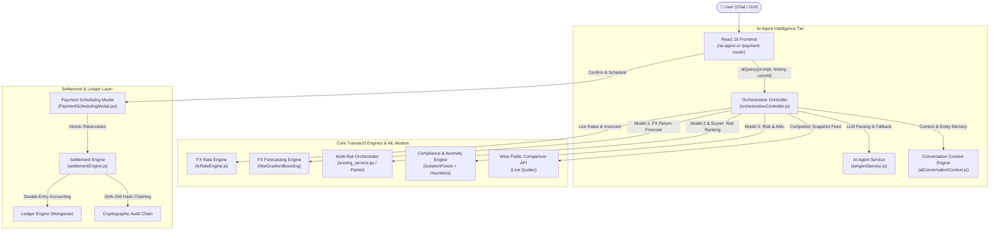

# 🤖 Transact3: Comprehensive User Journey with AI Transfer Agents

> **Executive Summary:** Transact3 features a modern **dual-interaction architecture**: users can manage transfers through a traditional visual GUI or interact entirely through an **intelligent, multi-turn AI Transfer Agent (`/ai-agent`)**. The AI Agent leverages Large Language Models (Groq / GPT-OSS), a deterministic conversational memory engine (`aiConversationContext.js`), and direct hooks into Transact3's multi-rail routing, machine learning models, and tamper-evident settlement ledger.

---

## 🏛️ System Architecture: The AI Agent Interaction Model



---

## 🎭 The 4 End-to-End User Journey Personas

---

### 🌟 Persona A: The Natural Language Transfer Journey
*Scenario: A user wants to remit funds to Europe as fast as possible using plain English conversational prompts.*

```
User: "Send 1,000 USD to EUR fastest"
   │
   ▼
[Step 1: Intent & Entity Parsing]
• Groq LLM parses: Intent = TRANSFER_REQUEST, Amount = 1000, Source = USD, Dest = EUR, Priority = FASTEST.
• aiConversationContext builds active context (Version 1).
   │
   ▼
[Step 2: Multi-Rail Optimization & ML Inference]
• Rail Scorer evaluates 3 rails with FASTEST weights (Speed: 0.70, Cost: 0.10).
• Recommends: CARD_PUSH (~9 min delivery, $3.50 fee + 15 bps).
• Model 3 verifies compliance risk: Score 0.08 (LOW - Straight-Through Processing).
   │
   ▼
[Step 3: Interactive Agent Presentation]
• Agent chat bubble displays:
  - Natural summary + fee and speed breakdown.
  - Interactive Rail Card showing CARD_PUSH vs REGIONAL_INSTANT vs SWIFT.
  - Contextual Suggestion Chips: ["Why is this option recommended?", "Show me cheapest", "Compare with Western Union"]
  - Primary Action Button: [ Schedule Transfer ]
   │
   ▼
[Step 4: Recipient Verification]
• User clicks [ Schedule Transfer ].
• Agent checks recipient: "To schedule this transfer, I need the recipient's email address. Your saved recipients: alice@corp.de, bob@fin.eu".
• User types: "alice@corp.de".
   │
   ▼
[Step 5: Pre-filled Scheduling Modal & Atomic Lock]
• Modal opens automatically with parameters pre-populated.
• 60-second binding FX quote locked.
• User clicks "Confirm & Schedule".
• Sender wallet funds reserved + rail liquidity capacity reserved.
• Status: SCHEDULED.
   │
   ▼
[Step 6: Asynchronous Settlement & Cryptographic Inscription]
• 1-second cron worker identifies due transaction.
• Simulates payment clearing, debits sender, credits Alice's EUR wallet.
• Appends SHA-256 tamper-evident audit block. Status: COMPLETED.
```

---

### 📈 Persona B: The Market Analyst Journey (Contextual FX Forecasting)
*Scenario: A user researches currency exchange rate trends, follow-ups without repeating currency names, and asks for timing recommendations.*

```
Turn 1 ──► User: "How much is SGD to INR?"
           Agent: "1 SGD = 64.8327 INR (as of Oct 2026 mid-market). How much would you like to convert?"
           [Context Engine stores: Base = SGD, Target = INR, Action = CONVERT]

Turn 2 ──► User: "OK, check its forecast."
           Agent: [Context Engine resolves pronoun "its" -> SGD/INR (does NOT reset to USD/INR!)]
                  • Invokes Model 1 (HistGradientBoostingRegressor).
                  • Generates 24h & 7-day projection: "FX Forecast for SGD → INR: Expected +0.42% appreciation."
                  • Displays interactive chart & technical indicators (SMA, EMA, RSI).

Turn 3 ──► User: "Should I convert now or wait?"
           Agent: [Context Engine inherits SGD/INR context]
                  • Analyzes momentum indicators.
                  • Returns Timing Badge: "WAIT_6H (Expected savings: ~₹275 INR due to upward momentum)."

Turn 4 ──► User: "Make it 500 SGD."
           Agent: [Deterministic correction parser updates amount while preserving pair]
                  • "500 SGD = 32,416.35 INR at current spot rate."
                  • Suggestion Chips: ["Schedule transfer for 500 SGD", "Compare providers"]
```

---

### 🛡️ Persona C: The Compliance & Risk Gatekeeper Journey
*Scenario: A user attempts an unusual transfer that triggers regulatory compliance checks.*

```
User: "Send 9,850 USD to Global Trading in Berlin right now"
   │
   ▼
[Step 1: Machine Learning & AML Screening]
• Model 3 (IsolationForest) evaluates the feature vector:
  - Amount Log: ln(9851)
  - Time of day: 02:30 AM UTC (Off-hours flag = 1)
  - Velocity 24h: 3rd transfer today
  - Structuring check: Amount between $9,000 and $9,999 -> Flagged!
• Fuzzy AML Engine (Jaro-Winkler + Soundex) matches "Global Trading" against OFAC lists.
   │
   ▼
[Step 2: Risk Scoring & Tier Assignment]
• AI Agent computes Composite Risk Score: 0.62.
• Assigned Tier: MEDIUM (Enhanced Due Diligence).
• Trigger Flag: [ STRUCTURING_SUSPICION: Transfer is just below BSA $10k mandatory threshold ].
   │
   ▼
[Step 3: Conversational Compliance Guidance]
• The Agent politely informs the user:
  "This transfer has been flagged for regulatory review under standard AML guidelines (Amount near $10,000 reporting threshold). 
   Secondary two-factor verification (OTP) will be required at settlement confirmation."
• Straightforward transfers continue without friction; suspicious patterns are held for safety.
```

---

### 🔄 Persona D: The Cross-Modal Handoff (Dashboard $\to$ AI Agent $\to$ Settlement)
*Scenario: A user starts on the dashboard search bar and seamlessly transitions to the AI Agent.*

1. **Dashboard Entry (`/`):** User types in the quick query box: *"Send 5,000 INR to USD cheapest"*.
2. **State Handoff:** React Router passes `location.state = { initialMessage: "Send 5,000 INR to USD cheapest" }` to `/ai-agent`.
3. **Automated Submission:** The AI Agent receives the handoff, initializes a fresh `conversationId`, renders the user prompt, and invokes `aiQuery()` automatically.
4. **Interactive Routing:** Agent displays the `BALANCED` vs `CHEAPEST` comparison and recommends `REGIONAL_INSTANT` (domestic netting).
5. **Direct Settlement:** User selects a beneficiary, confirms via the pre-filled modal, and returns to `/wallet` where the new transaction appears in the live activity feed.

---

## 🔍 Deep-Dive: Behind the Scenes of the AI Agent

### 1. Intent Classification Hierarchy (`aiAgentService.js`)
The agent classifies user requests into **26 discrete intents**, preventing cross-contamination:

| Intent Category | Supported Intents | Example User Queries |
| :--- | :--- | :--- |
| **Transfer Operations** | `TRANSFER_REQUEST`, `CHEAPEST_TRANSFER`, `FASTEST_TRANSFER`, `TRANSFER_COMPARISON` | *"Transfer 200 EUR to USD"*, *"What's the cheapest way to send money to India?"* |
| **Financial Intelligence** | `CURRENCY_CONVERSION`, `FX_FORECAST`, `FX_TIMING_ANALYSIS`, `COMPETITOR_COMPARISON` | *"How much is 100 USD in GBP?"*, *"Will the Euro go up tomorrow?"*, *"Compare with Wise"* |
| **Portfolio & Wallet** | `WALLET_BALANCE`, `WALLET_HOLDINGS`, `TRANSACTION_HISTORY`, `TRANSACTION_STATUS` | *"What's my INR balance?"*, *"Show my recent transfers"*, *"Status of payment PAY-102"* |
| **Clarification & Edits** | `CLARIFICATION_RESPONSE`, `WHAT_IF_ANALYSIS` | *"Make it 500"*, *"Change destination to EUR"*, *"What if I increase the amount?"* |
| **General & Safety** | `TRANSACT3_PLATFORM_QUESTION`, `GENERAL_KNOWLEDGE`, `OUT_OF_SCOPE` | *"How does Transact3 work?"*, *"What's the capital of France?"* *(Does not trigger transfers)* |

---

### 2. The Deterministic Context Engine (`aiConversationContext.js`)

To solve LLM hallucinations, forgotten currency pairs, and out-of-order currencies, Transact3 uses a dedicated **Conversation Context Engine**:

```
User Message: "How much is SGD to INR?"
     │
     ▼
[detectExplicitPairs]
• Scans regex in sentence order: "SGD" appears before "INR".
• Sets: sourceCurrency = 'SGD', destinationCurrency = 'INR' (never reversed).
     │
     ▼
[buildActiveContext]
• Bounded to last 10 financial messages.
• Assigns contextVersion (e.g., v1).
     │
     ▼
User Follow-up: "Check its forecast"
     │
     ▼
[mergeIntentWithContext]
• Explicit entities in newest prompt take precedence.
• Missing entities are inherited from active context:
  - sourceCurrency: 'SGD' (retained)
  - destinationCurrency: 'INR' (retained)
• New Intent: FX_FORECAST replaces CURRENCY_CONVERSION (intent switch allowed on same pair).
• Audit trail generated: { fieldsRetained: ['sourceCurrency', 'destinationCurrency'], resolutionDecision: 'INHERITED_ACTIVE_PAIR' }
```

---

### 3. Financial Safety & Non-Financial Isolation Guardrails

1. **Zero Fake Transfers:** General conversation, conversion queries, or FX forecasts **never set `currentParams`**. The "Schedule Transfer" button is mathematically impossible to display unless an explicit `TRANSFER` intent occurred.
2. **Deterministic Pair Validation:** The FX forecasting engine validates that the ML model output matches the user's requested pair. If the pair is unsupported, it returns an honest explanation rather than substituting an arbitrary pair.
3. **Permanent AI Disclaimer:** A subtle, mobile-responsive regulatory disclaimer (`role="note"`) is rendered below the input bar on `/ai-agent` to ensure users verify financial rates prior to commitment.

---

## 📊 Summary Comparison: Visual GUI vs. AI Agent Journey

| Dimension | Visual GUI (`/payment-router`) | AI Transfer Agent (`/ai-agent`) |
| :--- | :--- | :--- |
| **Input Method** | Dropdowns, radio buttons, numeric inputs | Natural language text or speech ("Send 100 USD to INR") |
| **Corridor Selection** | Manual currency picker | Automatic entity recognition from text |
| **Follow-up Analysis** | Must navigate to `/fx-forecasting` | Seamless multi-turn dialog (*"Check its forecast"*, *"Should I wait?"*) |
| **Corrections** | Manually re-typing form inputs | Natural conversational edits (*"Make it 500"*, *"Use EUR instead"*) |
| **Transfer Confirmation** | Modal triggered from Route Table | Modal triggered directly from chat bubble |
| **Transparency** | Tabular cards with numerical scores | Conversational reasoning explaining *why* a route was selected |
| **Underlying Engine** | Multi-Objective Pareto Scorer & Settlement Engine | Exact same backend, ML models, and double-entry ledger |

---

## 🚀 Execution & Verification

The complete AI Agent implementation and context suites are verified with:

```powershell
# Run the 49 automated multi-turn context regression tests:
cd server
node test-ai-context.js

# Run live endpoint tests against the running backend:
node test-ai-context-live.js
```
*Both suites confirm 100% test pass rates across multi-turn pair retention, corrections, ambiguity handling, and transfer isolation.*
